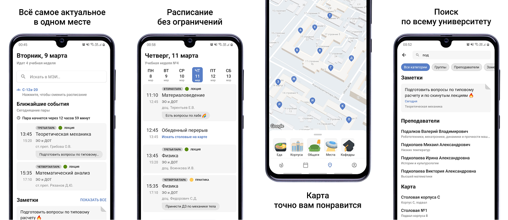
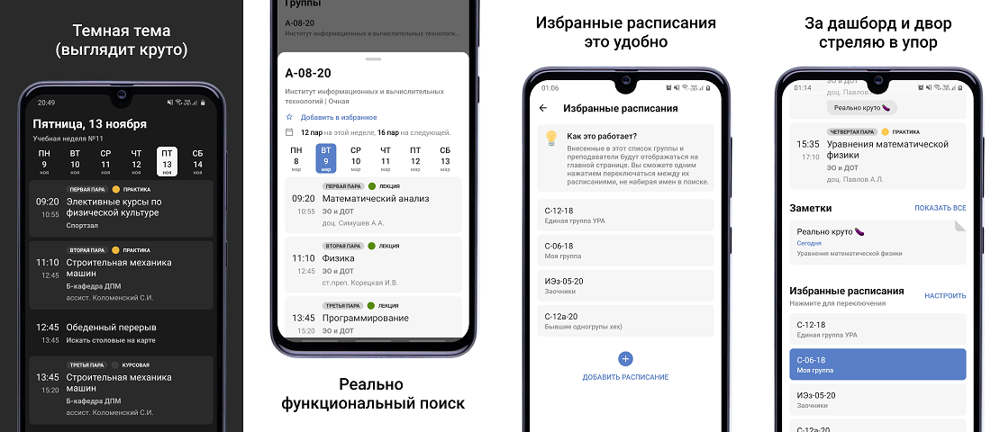

# MpeiX - приложение МЭИ здорового человека

> 🚧 **Проект в активной фазе рефакторинга** 🚧

 

  

Расписание пар, заметки, личный кабинет БАРС и крутая карта для студентов и преподавателей НИУ МЭИ. Самое функциональное, легковесное и стабильное МЭИшное приложение.

**Фичи приложения:**
+ Просмотр расписаний **групп и преподавателей**
+ Карта корпусов, общежитий, мест общепита, известных мест кампуса МЭИ и кафедр.
+ Добавление **заметок** к парам.
+ Просмотр ЛК **БАРС**.
+ Дашборд с ближайшими парами, заметками, расписанием сессии и объявлениями.
+ Быстрое переключение между **избранными расписаниями**.
+ Переключение между **ТЁМНОЙ ТЕМОЙ** и светлой темой.
+ Переключение между русским и английским языком в приложении.
+ Поиск по заметкам, карте, группам и преподавателям.
+ Предпросмотр расписаний групп и преподавателей прямо с экрана поиска.
+ Кэширование расписаний и геометок на устройстве.
+ Поддержка версии для планшетов.
+ Самый маленький вес приложения по сравнению с конкурентами.
+ Открiтый исходнiй код.
+ Меми.🤗💪😸😃

Пулл реквесты приветствуются.

### Скриншоты

### Требования приложения

+ Android 8.0 и выше (Api V26+)
+ Доступ к интернету

## Интересное для разработчиков

### Стек

+ **Jetpack Compose** + **Material 3** для UI
+ TEA/ELM для presenter слоя на базе Vivid Money [**Elmslie**](https://github.com/vivid-money/elmslie)
+ **Navigation 3** (`androidx.navigation3`) с собственной обёрткой `Router` в `lib_navigation`
+ **Retrofit** + **OkHttp** + **kotlinx.serialization** для REST Api
+ **Kotlin Coroutines + Flow** во всем приложении, ни капельки RxJava
+ **Room** + **KSP** для хранения в БД заметок и избранных расписаний
+ **MMKV** и **DataStore** для хранения настроек и кэша
+ **Firebase**: Crashlytics, Analytics, Remote Config
+ **Coil** для загрузки картинок
+ **DI Koin**
+ **Chucker** и мок-сервер на **Ktor** (`mock_server`) в debug/qa сборках
+ Для тестирования используется **JUnit 5** + [**Kotest**](https://github.com/kotest/kotest) и **kotlin.test**
+ Композитный билд и кастомные Gradle плагины: много всяких интересных штук смотри в `./build-logic`
+ Для импорта ресурсов из Figma в проект используется тулза [**figx**](https://github.com/tonykolomeytsev/figx)

### Архитектура

В проекте используется **Clean Architecture**, в некоторых местах допускаются упрощения.

Если хотите разобраться в устройстве проекта, специально для вас создан файлик [ARCHITECTURE.md](https://github.com/tonykolomeytsev/mpeiapp/blob/master/ARCHITECTURE.md).

### Планы на будущее

1. Завершение перехода на Jetpack Compose: большая часть экранов уже переведена, остались 
   `ScheduleFragment`, `DashboardFragment` и боттом-шиты, которые пока обёрнуты в `ComposeBottomSheetDialogFragment`.
2. Редизайн приложения в соответствии с новыми гайдлайнами Material 3 и более новых.
3. Полировка существующих фич и добавление нового функционала. Новые фичи сейчас на стадии рисовки 
   в Figma. Добавляться будут только реально необходимые функции. Лишная фигня, которой пользуются 
   раз в год и которую сложно поддерживать, в приложении появляться не будет.

### Инструкция по сборке проекта

1. Создайте на Firebase два конфига `google-services.json`:
   - Для release версии приложения (package name `kekmech.ru.mpeiapp`): 
     положите конфиг в корень модуля `modules/app`
   - Для debug версии приложения (package name `kekmech.ru.mpeiapp.dev`): 
     положите конфиг в `modules/app/src/debug` и `modules/app/src/qa` (да просто скопипастить два раза). 

   [**Инструкция**](https://support.google.com/firebase/answer/7015592?hl=en) по получению `google-services.json`.

1. В глобальный `~/.gradle/gradle.properties` добавьте поле `mpeiapp_google_maps_api_key=YOUR_KEY`, где `YOUR_KEY` - ключ от API Google Maps (без кавычек, иначе они попадут в значение ключа). На CI ключ берется из переменной окружения `MAP_KEY`. [**Инструкция**](https://developers.google.com/maps/gmp-get-started) по получению ключа.

1. Скачайте и установите JDK 17 версии, укажите в настройках проекта java 17 по умолчанию для Gradle и компилятора Kotlin:

   - Windows/Linux: `File -> Settings -> Build, Execution, Deployment -> Build Tools -> Gradle`
   - macOS: `Android Studio -> Settings… -> Build, Execution, Deployment -> Build Tools -> Gradle`

1. Установите плагин **Kotest**, с ним будет проще гонять тесты.

После первых двух пунктов проект соберется, после двух других начнут работать тесты. Для сборки нужен JDK 17: все модули компилируются под JVM 17.

По понятным причинам в репозитории не будут опубликованы оригинальные ключи от Google Maps API и Firebase API. Используйте свои ключики.
